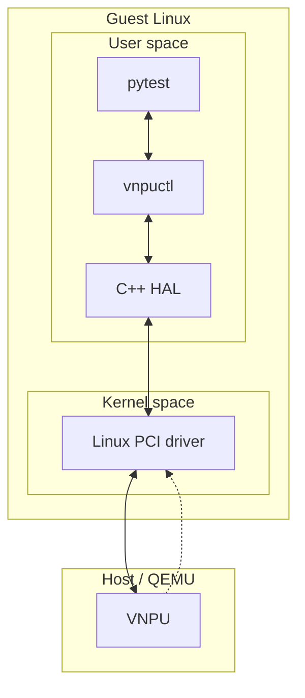

# Project: Linux Driver Integration Testing with a Virtual PCI Device

# Overview

실제 하드웨어 대신 가상 PCI 디바이스를 구현하고, 사용자 프로그램에서 드라이버를 거쳐
장치를 제어할 때의 연산 결과와 오류 전달을 테스트하는 프로젝트이다.

이를 위해 QEMU 가상 PCI 장치와 Linux 드라이버, C++ HAL, User Tool를 구현했다.
pytest로 전체 경로의 연산 결과를 기대값과 비교하고, 오류를 의도적으로 주입해
error response과 result corruption을 확인하는 자동 테스트를 구성했다.

통합 테스트는 Normal test와 Fault injection으로 구성했다.
Normal test에서는 무작위 입력의 결과를 Python 기대값과 비교해 정확성을 확인했다.
Fault injection에서는 고정 입력에 오류를 하나씩 주입하고, error response/result corruption/
드라이버 카운터 변화를 판정하도록 구성했다.

# Architecture

이 프로젝트는 **연산을 요청하는 쪽**, **장치를 제어하는 쪽**, **연산을 수행하는 장치**를
다섯 계층으로 연결했다. 요청은 pytest에서 장치로 내려가고,
결과나 오류는 반대 방향으로 돌아온다.

## System Structure



실선은 요청과 결과가 오가는 경로이고, 점선은 장치가 드라이버에 보내는 완료·오류 알림이다.

QEMU는 host에서 가상 장치를 구현한다. Guest Linux에서는 이 장치를 PCI 장치로 인식하고,
커널의 드라이버를 통해 제어한다. pytest와 CLI, HAL은 guest의 사용자 공간에서
동작하며, HAL은 CLI에 포함된 라이브러리이다.

## Layer Roles

| 계층 | 역할 |
| --- | --- |
| pytest | 테스트 입력과 기대값을 준비하고, 실행 결과가 기대한 동작과 일치하는지 판정한다. |
| CLI (vnpuctl) | 연산·정보 조회·오류 주입 등의 요청을 명령으로 받아 HAL에 전달하고, 응답을 출력한다. |
| C++ HAL | 장치 기능을 공통 API로 제공하고, 프로그램의 요청을 드라이버가 처리할 수 있는 형식으로 변환한다. |
| Linux PCI 드라이버 | 운영체제 안에서 장치를 관리하며, 요청을 장치에 전달하고 완료 여부와 결과를 확인한다. |
| QEMU 가상 장치 (VNPU) | 입력에 대한 내적 연산을 수행하고 결과와 상태를 제공한다. 검증을 위한 오류 상황도 재현한다. |

장치 접근에 필요한 변환과 자원 관리는 HAL에 모아, CLI가 드라이버의 세부 규약을
직접 다루지 않도록 했다. 

## Layer Interactions

- **pytest ↔ CLI**

  pytest는 입력을 준비하고 CLI를 실행한다. CLI는 요청을 수행한 뒤 결과나 오류를
  JSON으로 출력하고, pytest는 이 응답을 기대값 또는 오류 시나리오의 판정 조건과 비교한다.
  같은 CLI를 사용자가 직접 실행해 장치를 제어할 수도 있다.

- **CLI ↔ HAL**

  CLI는 사용자가 지정한 명령과 입력을 해석해 HAL에 기능을 요청한다.
  HAL에서 돌려받은 결과나 오류를 응답으로 출력하므로, CLI가 드라이버의 요청 형식을
  직접 구성할 필요는 없다.

- **HAL ↔ Driver**

  HAL은 입력을 검사하고 드라이버의 요청 형식으로 변환한다.
  드라이버가 요청 처리를 마치면 HAL은 반환된 결과와 주요 오류를 C++ 프로그램에서
  사용할 수 있는 형태로 바꿔 CLI에 돌려준다.

- **Driver ↔ Device**

  드라이버는 장치에 입력과 제어 명령을 기록하고 완료를 기다린다.
  장치는 연산 후 완료나 오류를 알리고, 드라이버는 상태와 결과를 읽어 상위 계층에 반환한다.
  정해진 시간 안에 알림을 받지 못하면 장치를 초기화하고 시간 초과 오류를 전달한다.

연산 결과의 정확성은 최종적으로 pytest가 판정한다.
장치가 정상 완료를 보고하더라도 결과가 기대값과 다르면 pytest에서 그 차이를 확인한다.

# Validation

검증 대상은 **CLI → HAL → 드라이버 → 가상 장치로 연결된 전체 실행 경로**이다.
정상 입력에서는 요청이 장치까지 전달되어 올바른 결과가 반환되는지 확인한다.
오류를 주입했을 때는 예상한 오류 응답이 사용자 프로그램까지 전달되는지 확인한다.
정상 완료 응답만으로는 결과의 정확성을 보장할 수 없으므로, Python 기대값과의 비교로
결과 손상도 확인한다.

이를 위해 pytest가 CLI로 요청을 실행하고, 반환된 응답과 실행 전후의 드라이버 카운터를
판정한다. 검증 과정은 정상 연산 검증과 오류 시나리오 검증으로 나눈다.

## Normal Tests ([ref](#ref-normal-tests))

- **Input**: 두 INT8 vector와 timeout을 CLI에 전달한다. 고정 입력과 seed `5055` 기반
  무작위 입력을 사용하며, vector 길이는 8/16, timeout의 범위는 125~1000ms이다.
- **Output**: 전체 실행 경로를 거쳐 반환된 연산 결과와 성공·오류 상태를 JSON으로 받는다.
- **Validation**: Python으로 계산한 기대값과 연산 결과가 정확히 일치하는지 확인한다.
  응답은 성공 상태여야 하며, 오류가 있으면 실패로 판정한다.
  드라이버 카운터에서 연산 한 건당 제출·완료 횟수가 각각 1 증가하는지도 확인한다.

## Fault Injection Tests ([ref](#ref-fault-injection-tests))

- **Input**: 고정된 연산 입력만 사용하며, 무작위 입력은 사용하지 않는다.
  Fault bit 하나를 설정해 오류를 주입하고, 테스트 전후에는 reset으로 상태를 정리한다.
- **Output**: CLI의 성공·오류 응답, 반환된 연산 결과, 실행 전후의 드라이버 카운터를 읽는다.
- **Validation**: 응답과 결과가 주입한 fault의 기대 동작에 맞는지 확인하고,
  카운터 변화량이 아래 기준과 일치하는지 비교한다. 준비·정리 reset은 비교 구간에서 제외한다.

| Fault | 응답·결과 판정 | 드라이버 카운터 |
| --- | --- | --- |
| IRQ drop | 시간 초과 오류 | submitted +1, timed_out +1 |
| Stuck busy | 시간 초과 오류 | submitted +1, timed_out +1 |
| Corrupt result | 성공 응답이지만 Python 기대값과 결과 불일치 | submitted +1, completed +1 |
| Force error | 장치 오류 응답 | submitted +1, device_error +1 |

드라이버 카운터의 의미는 다음과 같다.

- **submitted**: 장치에 연산을 제출한 횟수이다.
- **completed**: 정상 완료로 처리한 연산 횟수이다.
- **timed_out**: 연산 완료를 기다리다 제한 시간을 넘긴 횟수이다.
- **device_error**: 장치의 오류 알림을 받은 횟수이다.
- **resets**: 명시적 reset 요청이 성공한 횟수이다. Timeout 처리 중 자동 reset은 제외한다.

## Component Tests ([ref](#ref-component-tests))

통합 테스트와 별도로, 각 계층에 직접 접근하는 개별 테스트를 구성했다.

- **Device**: 셸 스크립트와 C 테스트 도구로 드라이버를 거치지 않고 가상 장치에 접근한다.
  초기 상태·연산 결과·result corruption을 기대값과 비교한다.
- **Driver**: C 테스트 도구로 HAL·CLI를 거치지 않고 드라이버에 직접 요청한다.
  정보 조회·고정 입력 연산·카운터 조회를 실행하고, 호출 성공 여부를 확인하며 반환값을 출력한다.
- **HAL**: GoogleTest로 mock 구현의 연산·입력 검사·오류 처리·reset 동작을 확인한다.
  QEMU와 드라이버는 실행하지 않으며, Linux HAL의 장치 접근 경로는 포함하지 않는다.

## Validation Results

| 날짜 | 환경 | 검증 항목 | 결과 |
| --- | --- | --- | --- |
| 2026-10-19 | Host | Mock GoogleTest | 12건 통과 |
| 2026-10-19 | Buildroot toolchain | CLI·ioctl smoke·MMIO smoke 교차 빌드 | 빌드 성공 |
| 2026-09-11 | QEMU guest / Buildroot | Revision B 무작위 입력 | JUnit 기준 1,000건 통과, 실패·오류·skip 0건 |

pytest 실행 결과는 JUnit XML로 저장한다.

# Quick Start

## 1. 환경 준비 — Host

`BUILDROOT_DIR`를 Buildroot를 설치할 경로로 지정한다.
스크립트는 소스와 필수 설정을 준비하고, 가상 머신에 사용할 커널·파일시스템·QEMU를 빌드한다.

```sh
export BUILDROOT_DIR="$HOME/src/buildroot"
./scripts/setup-sources.sh
```

## 2. 빌드와 VM 부팅 — Host

Guest용 드라이버와 CLI를 빌드하고, 가상 PCI 디바이스가 포함된 QEMU 가상 머신을 부팅한다.

```sh
export VNPU_CROSS="$BUILDROOT_DIR/output/host/bin/x86_64-buildroot-linux-gnu-"

make -C linux-driver modules \
  KDIR="$BUILDROOT_DIR/output/build/linux-6.18.7" \
  ARCH=x86_64 CROSS_COMPILE="$VNPU_CROSS"
make -B -C cpp-hal CXX="${VNPU_CROSS}g++" LDFLAGS=-static

QEMU_BIN="$BUILDROOT_DIR/output/host/bin/qemu-system-x86_64"
./scripts/run-qemu.sh
```

## 3. 장치 연산 — Guest (root)

Guest에 root로 로그인한 뒤 드라이버를 로드한다.
예제 입력 파일을 만들고 CLI로 가상 디바이스의 내적 연산을 실행한다.

```sh
cd /mnt/repo
insmod linux-driver/vnpu-drv.ko
./tools/vnpuctl reset --json

cat > /tmp/vnpu-dot.json <<'JSON'
{
  "input_a": [1, 2, 3, 4, 5, 6, 7, 8],
  "input_b": [1, 1, 1, 1, 1, 1, 1, 1],
  "timeout_ms": 255
}
JSON
./tools/vnpuctl run-dot --input /tmp/vnpu-dot.json --json
```

## 4. 자동 검증 — Guest

저장소의 고정 입력 파일로 테스트한다. 추가 사례가 필요하면 `python-tests/inputs/input*.json`으로 작성한다.
pytest로 통합 테스트를 실행하고 결과를 터미널에서 확인한다.

```sh
mkdir -p python-tests/inputs/debug
./tools/vnpuctl reset --json
pytest -c python-tests/pytest.ini python-tests
```

# Limitations

- **하드웨어 재현 범위**: 장치는 소프트웨어로 구현한 기능 모델이다.
  실제 칩과 보드의 물리적 특성·세부 타이밍은 재현하지 않으며, 측정 시간을 실제 장치의 성능으로 해석할 수 없다.
- **연산과 처리 범위**: 정수 내적과 한 번에 하나의 연산을 처리하는 구조에 한정된다.
  신경망 전체 실행이나 여러 작업의 병렬 처리는 다루지 않는다.
- **오류 검증 범위**: 소프트웨어로 미리 정한 오류 상황을 주입해 동작을 확인한다.
  실제 하드웨어에서 발생하는 복합 오류나 불규칙한 장애를 포괄하지는 않는다.
- **검증과 자동화 범위**: 실행 근거는 일부 테스트 기록에 한정되며, 전체 테스트의 통과를 보장하지 않는다.
  가상 머신 부팅부터 전체 테스트 실행·결과 수집까지의 자동화는 아직 갖추지 않았다.

# Implementation & References

Validation의 테스트 분류에 맞춰 관련 코드와 실행 기록을 정리했다.

<a id="ref-normal-tests"></a>

## Normal Tests

- [고정 입력 테스트](python-tests/test_run_dot.py): 연산 결과와 성공 상태를 확인한다.
- [무작위 입력 테스트](python-tests/test_random_seed.py): 고정 seed로 생성한 입력의 결과를 기대값과 비교한다.
- [기대값 모델](python-tests/reference_model.py): Python 정수 내적으로 기대값을 계산한다.
- [장치 정보 테스트](python-tests/test_info.py): 장치 정보와 revision을 확인한다.
- [카운터 테스트](python-tests/test_stats.py): 정상 연산과 reset 전후의 카운터 변화를 확인한다.
- [CLI 실행 도구](python-tests/conftest.py): pytest에서 CLI를 실행하고 JSON 응답을 읽는다.

<a id="ref-fault-injection-tests"></a>

## Fault Injection Tests

- [오류 주입 테스트](python-tests/test_inject_fault.py): 고정 입력에 fault를 주입하고 오류 응답과 결과 손상을 확인한다.
- [카운터 테스트](python-tests/test_stats.py): 오류 주입 전후의 응답과 카운터 변화를 비교한다.

<a id="ref-component-tests"></a>

## Component Tests

- [장치 확인 스크립트](scripts/vnpu-devmem-smoke.sh): 가상 장치에 직접 접근해 초기 상태·연산 결과·결과 손상을 확인한다.
- [장치 확인 C 도구](qemu-device/tests/src/vnpu-mmio-smoke.c): 초기 상태·연산 결과·결과 손상·잘못된 입력 길이를 확인한다.
- [드라이버 확인 C 도구](linux-driver/tests/vnpu-ioctl-smoke.c): 정보 조회·고정 입력 연산·카운터 조회를 직접 호출한다.
  호출 성공 여부를 확인하고 반환값을 출력하며, 결과를 기대값과 자동 비교하지는 않는다.
- [HAL GoogleTest](cpp-hal/tests/mock-gtest.cpp): mock 구현의 연산·입력 검사·오류 처리·카운터·reset을 확인한다.
  Linux backend와 드라이버는 실행하지 않는다.

## Implementation & Execution Records

| 주제 | 관련 코드 및 기록 |
| --- | --- |
| 가상 장치 | [QEMU 장치 모델](qemu-device/src/vnpu.c) |
| 드라이버와 사용자 인터페이스 | [PCI 드라이버](linux-driver/src/vnpu_drv.c), [ioctl 인터페이스](linux-driver/include/vnpu_uapi.h) |
| HAL과 CLI | [HAL 인터페이스](cpp-hal/include/vnpu/vnpu-hal.hpp), [HAL 구현](cpp-hal/src/vnpu-hal.cpp), [CLI 구현](cpp-hal/src/vnpuctl.cpp) |
| 환경 준비와 실행 | [버전 기록](docs/versions.md), [Buildroot 설정](buildroot/configs/vnpu_qemu_x86_64_defconfig), [소스 준비](scripts/setup-sources.sh), [QEMU 실행](scripts/run-qemu.sh), [pytest 실행](scripts/run-test.sh) |
| 빌드와 CI | [HAL 빌드](cpp-hal/Makefile), [드라이버 빌드](linux-driver/Makefile), [장치 테스트 빌드](qemu-device/tests/Makefile), [CI 설정](.github/workflows/ci.yml) |
| 과거 실행 결과 | 로컬 `artifacts/pytest/vnpu-revision-a.xml` (Git 제외, 내부 사례명은 Revision B) |
| 검증 실행 이력 | [검증 기록](docs/validation-record.md) |
